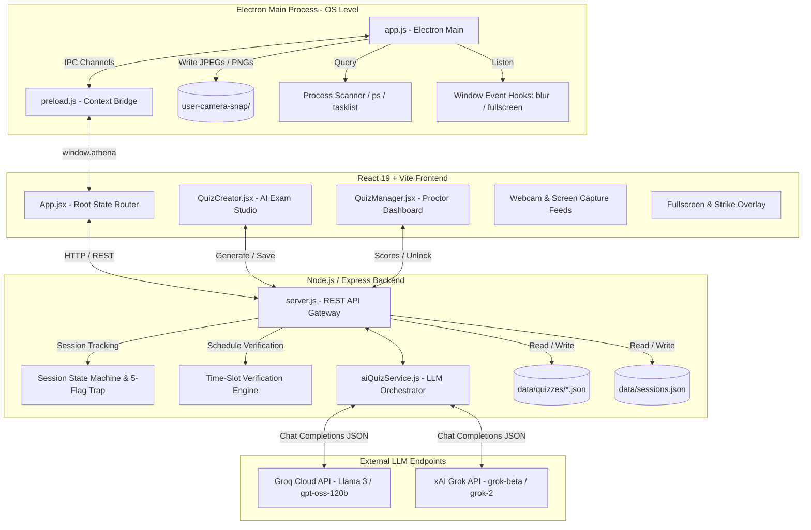
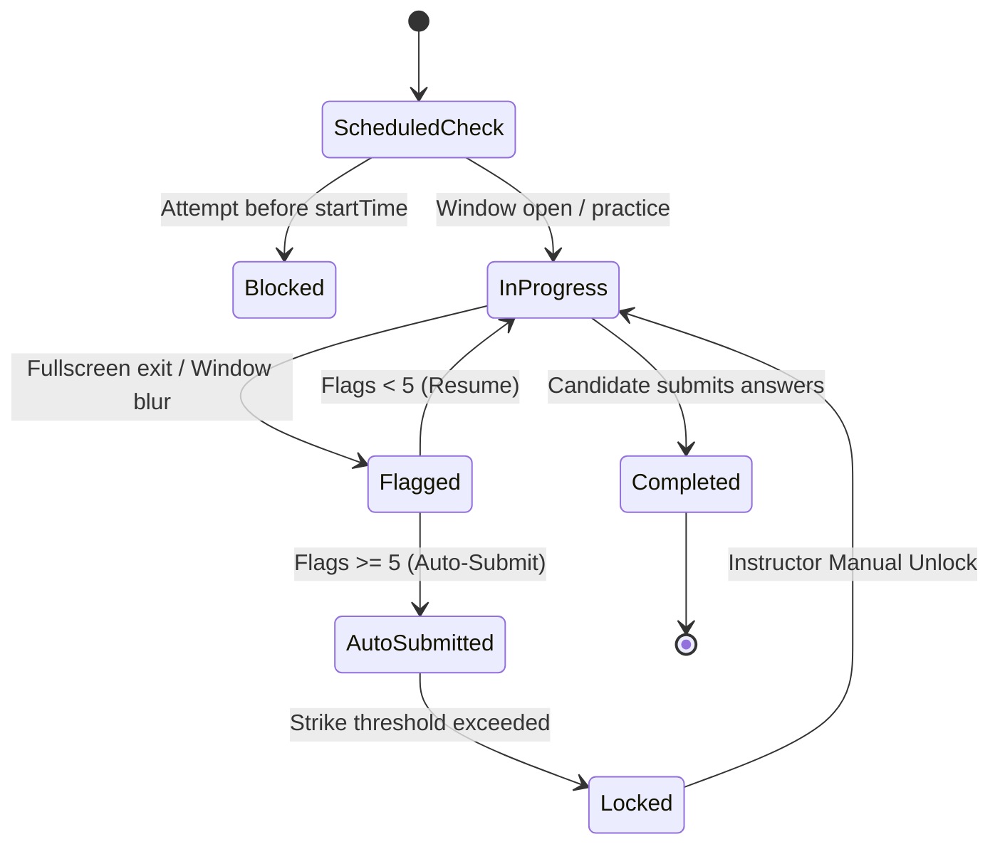
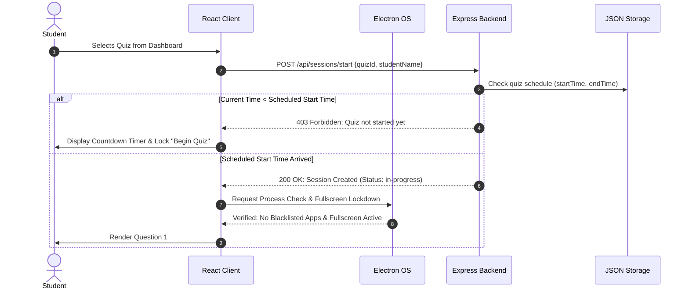
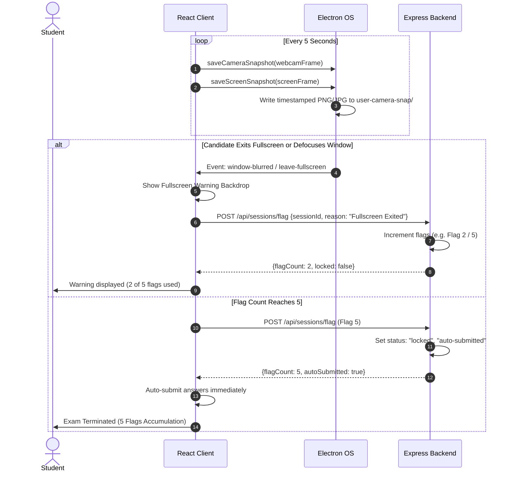

# Athena Proctoring & Examination System — Complete Architecture

This document provides a comprehensive technical overview of the architecture, subsystems, data flows, security mechanisms, AI integration, and file schemas powering the **Athena Proctoring & Assessment Platform**.

---

## 1. Executive Overview

Athena is an enterprise-grade, desktop-first proctoring and assessment platform engineered to conduct secure, scheduled digital examinations. The system blends a responsive **React 19 / Vite** single-page application, an **Electron** desktop runtime with operating-system lockdown capabilities, an **Express / Node.js** backend state machine, and an **LLM-driven AI Quiz Generator** (Groq / xAI Grok).

### Core Capabilities
* **AI-Assisted Assessment Studio**: Instructors can generate domain-specific examinations on demand with tailored parameters (difficulty, format, count, time limit) and precise custom AI guidelines.
* **Strict Time-Slot Scheduling**: Quizzes enforce official examination windows (by default starting 5 minutes after creation). Attempts before the window are blocked; late/outside attempts are segregated as unofficial practice.
* **Multi-Layered Proctoring Engine**: Combines webcam face surveillance, full-desktop screen capture, fullscreen departure detection, window blur/app-switching monitoring, and background process scanning.
* **5-Flag Strike Policy**: Violations incrementally trigger warnings; upon reaching 5 strikes, the session auto-submits and locks immediately.
* **Structured Snapshot Archiving**: Automatically stores camera and screen captures into a hierarchical, isolated directory structure indexed by unique quiz tracking IDs and student names.

---

## 2. High-Level Architecture Diagram



---

## 3. Core Subsystems & Components

### 3.1 Presentation Layer (`proctoring-tool/src`)

The client is built using React 19 and Vite, styled with custom Vanilla CSS (`App.css`).

#### A. Student 4-Step Examination Pipeline
The student workflow follows an isolated, linear state machine:
1. **Step 1: Identity (`studentStep === 'identity'`)**: Candidate enters their full name and student ID.
2. **Step 2: Quiz Selection (`studentStep === 'quiz'`)**:
   - Lists **Ongoing & Scheduled Quizzes** (with live badges and scheduled start times).
   - Lists **Past Quizzes** (labeled as practice assessments).
   - Prevents starting any quiz whose scheduled start time has not yet arrived.
3. **Step 3: Device & System Readiness (`studentStep === 'permissions'`)**:
   - **Camera Feed Verification**: Obtains `getUserMedia` stream and presents a live preview.
   - **Screen Sharing Acquisition**: Requests full display sharing via `getDisplayMedia({ video: { displaySurface: 'monitor' } })`. Detects stream revoking via `track.onended`.
   - **Prohibited Background Application Scan**: In Electron, scans running processes against blacklisted communication (Discord, Zoom, Slack), remote desktop (AnyDesk, TeamViewer), and recording utilities (OBS).
4. **Step 4: Examination Instructions & Countdown (`studentStep === 'instructions'`)**:
   - Displays exam summary (duration, question count, pass score, rules).
   - *Instructor AI prompt instructions are deliberately kept private from candidates.*
   - If scheduled in the future, displays a live **Digital Countdown Clock** and disables the **Begin Quiz** button until the clock hits zero.
   - Triggers native Electron full-screen lockdown upon starting.
5. **Step 5: Active Exam Screen (`view === 'quiz'`)**:
   - Displays questions sequentially with radio options and a floating visual status widget (timer, flag counter, camera thumbnail, screen thumbnail).
   - No "Quit" button is present to prevent accidental fullscreen drops; examinees submit directly via **Submit Exam**.

#### B. Instructor Dashboard (`QuizManager.jsx`)
* **Quiz Management**: Create, edit, publish, or delete exams.
* **Audit & Session Monitoring**: Live table of candidates who took the quiz during the official scheduled window.
* **Practice vs. Official Segregation**: Candidates who took exams outside official time windows are segregated from official class gradebooks.
* **Folder Cleanup**: Deleting an assessment permanently purges its metadata and all associated disk capture folders (`user-camera-snap/<QuizTitle>_<QuizId>`).

#### C. Assessment Creator (`QuizCreator.jsx`)
* Instructors specify Title, Category, Difficulty, Question Count, Format (MCQ / True-False / Mixed), and Duration.
* **AI Guidelines Input**: Dedicated prompt instructions input allows instructors to define exact question styles, code vs. theory emphasis, edge-case distractor requirements, or specific subtopics.
* **Automatic Scheduling**: Default quiz schedule starts **5 minutes after creation** to give students preparation time.

---

### 3.2 Desktop Bridge & OS Security (`proctoring-tool/app`)

The Electron main process (`app.js`) and preload script (`preload.js`) provide native OS capabilities inaccessible to standard browser sandboxes.

```text
┌────────────────────────────────────────────────────────────────────────┐
│                        Electron Runtime Layer                          │
├────────────────────────────────┬───────────────────────────────────────┤
│ Window Lockdown & Focus        │ • leave-full-screen & blur listeners  │
│                                │ • globalShortcut registration         │
├────────────────────────────────┼───────────────────────────────────────┤
│ Process Enumeration            │ • ps -eo comm (macOS / Linux)         │
│                                │ • tasklist.exe (Windows)              │
├────────────────────────────────┼───────────────────────────────────────┤
│ Snapshot Storage               │ • app/user-camera-snap/               │
│                                │   └── <QuizName_QuizId>/              │
│                                │       └── <StudentName>/              │
│                                │           ├── camera-captures/        │
│                                │           └── screen-captures/        │
└────────────────────────────────┴───────────────────────────────────────┘
```

#### IPC Channels (`window.athena`)
* `athena.checkRunningProcesses()`: Asynchronously inspects OS process list against blacklist.
* `athena.lockQuizScreen()` / `athena.unlockQuizScreen()`: Toggles full-screen lockdown.
* `athena.saveScreenSnapshot(dataUrl, metadata)`: Saves timestamped desktop screenshot.
* `athena.saveCameraSnapshot(dataUrl, metadata)`: Saves timestamped webcam snapshot.
* `athena.deleteQuizCaptures(quizFolder)`: Purges disk snapshots when a quiz is deleted.

---

### 3.3 Backend Server & Integrity Engine (`backend/`)

The backend is built with Node.js and Express (`server.js`), operating on a local JSON database model for zero external database dependencies.

#### A. Key REST Endpoints

| Category | Method & Route | Description |
| :--- | :--- | :--- |
| **Quizzes** | `GET /api/quizzes` | Fetch all published/draft quizzes with schedule metadata |
| | `GET /api/quizzes/:id` | Fetch complete quiz by ID including questions |
| | `POST /api/quizzes/generate` | AI generate full quiz via Groq/Grok |
| | `POST /api/quizzes/regenerate-question` | AI regenerate single question |
| | `POST /api/quizzes/save` | Create/update quiz with schedule & tracking ID |
| | `DELETE /api/quizzes/:id` | Remove quiz and clear disk snapshot directory |
| **Sessions** | `POST /api/sessions/start` | Validate scheduled window & initialize attempt session |
| | `POST /api/sessions/flag` | Record integrity violation strike (fullscreen drop, blur) |
| | `POST /api/sessions/submit` | Finalize exam, evaluate score, lock session |
| | `GET /api/sessions/:sessionId` | Get attempt status and violation audit trail |
| **Scores & Audit** | `GET /api/scores` | Instructor overview of student scores (in-slot only) |
| | `GET /api/scores/:quizId` | Detailed gradebook and violation logs for quiz |
| | `POST /api/sessions/:sessionId/unlock` | Instructor manual override to unlock locked student |

#### B. Session State Machine



---

### 3.4 AI Quiz Engine (`backend/services/aiQuizService.js`)

The AI engine supports Groq Cloud and xAI Grok with automatic model fallback and JSON structure validation.

#### Provider Resolution & Model Hierarchy
1. **Groq Cloud** (API keys starting with `gsk_`):
   - Primary: `openai/gpt-oss-120b` (or `AI_MODEL` in `.env`)
   - Fallback: `qwen/qwen3.8-27b`
2. **xAI Grok**:
   - Primary: `grok-beta`
   - Fallback: `grok-2`

#### Custom Instruction Conditioning
When instructors provide instructions, they are injected directly into the LLM system prompt:
```text
- INSTRUCTOR'S SPECIAL GENERATION INSTRUCTIONS:
"<instructor guidelines>"
Follow these instructions precisely regarding what specific topics, subtopics,
scenario types, code vs concept, and style of questions to generate.
```

#### Output Sanitization
Responses are parsed using `response_format: { type: "json_object" }` with an extra regex parser cleanup fallback (`/\{[\s\S]*\}/`) to guarantee valid question array structures with correct answers and explanations.

---

## 4. End-to-End Data Flows

### 4.1 Exam Scheduling & Student Pre-Flight Sequence



### 4.2 Proctoring & 5-Flag Violation Workflow



---

## 5. Storage Architecture & File Schemas

### 5.1 Directory Layout
```text
NST_AD/
├── backend/
│   ├── data/
│   │   ├── quizzes/
│   │   │   └── <quizId>.json           # Individual quiz definitions
│   │   ├── sessions.json               # Student attempt records & flags
│   │   └── quizzes.json                # Seed / legacy quiz registry
│   ├── services/
│   │   └── aiQuizService.js            # LLM API orchestration
│   └── server.js                       # Express API & integrity rules
└── proctoring-tool/
    ├── app/
    │   ├── app.js                      # Electron main process
    │   ├── preload.js                  # IPC security bridge
    │   └── user-camera-snap/           # Proctoring media store
    │       └── <QuizName_QuizId>/
    │           └── <StudentName>/
    │               ├── camera-captures/
    │               └── screen-captures/
    └── src/
        ├── App.jsx                     # Student test-taking flow
        ├── components/
        │   ├── QuizCreator.jsx         # Assessment creation studio
        │   └── QuizManager.jsx         # Instructor management & grades
        └── services/
            └── examApi.js              # Frontend HTTP client
```

### 5.2 Quiz JSON Schema (`data/quizzes/<quizId>.json`)
```json
{
  "id": "percentage-595597-wzle",
  "title": "Percentage Mastery Quiz",
  "description": "Assessment on Percentage",
  "instructions": "Focus on real-world business scenarios, profit-loss, and multi-step word problems.",
  "category": "Mathematics",
  "difficulty": "Medium",
  "questionType": "MCQ",
  "durationMinutes": 10,
  "schedule": {
    "hasSchedule": true,
    "startTime": "2026-10-25T10:45:00.000Z",
    "endTime": "2026-10-25T10:55:00.000Z"
  },
  "status": "published",
  "createdAt": "2026-10-25T10:40:00.000Z",
  "updatedAt": "2026-10-25T10:40:00.000Z",
  "questions": [
    {
      "id": 1,
      "question": "If a shirt priced at $80 is discounted by 25%, what is the final sale price?",
      "options": ["$55", "$60", "$65", "$70"],
      "correctAnswer": 1,
      "explanation": "25% of 80 is 20. 80 - 20 = $60."
    }
  ]
}
```

### 5.3 Session Record Schema (`data/sessions.json`)
```json
{
  "sessionId": "sess-percentage-1792925400",
  "quizId": "percentage-595597-wzle",
  "studentName": "Aditya_Sharma",
  "studentId": "STU-9921",
  "startTime": "2026-10-25T10:46:12.000Z",
  "endTime": "2026-10-25T10:53:40.000Z",
  "status": "completed",
  "isPractice": false,
  "flagCount": 1,
  "flags": [
    {
      "timestamp": "2026-10-25T10:48:22.000Z",
      "reason": "Window focus lost / application switched",
      "strike": 1
    }
  ],
  "score": {
    "total": 5,
    "correct": 4,
    "percentage": 80,
    "passed": true
  }
}
```

---

## 6. Security & Anti-Cheating Protocol Summary

1. **Hardware Surveillance**: Continuous captures every 5 seconds for webcam (facial identity) and primary screen (content monitoring).
2. **Deterministic Fullscreen Trap**: Exiting fullscreen locks the interface immediately and posts an integrity strike to the backend.
3. **5-Strike Auto-Submission**: Violations are strictly limited. Accumulating 5 strikes executes an immediate auto-submit and locks the session.
4. **Schedule Window Guard**: Early exam attempts are prevented with a live synchronized countdown.
5. **Practice Segregation**: Examinees attempting quizzes outside scheduled windows are segregated to prevent skewed class statistics.
6. **Instruction Privacy**: AI question guidelines are isolated to backend prompt generation and hidden from examinees.
7. **Safe Disposal**: Deleting an exam permanently purges metadata and all associated disk capture folders.

---

## 7. Development & Runtime Reference

### Start Development Environment
```bash
# Terminal 1: Backend API Server
cd backend
npm start
# Runs at http://localhost:3000

# Terminal 2: React Web Frontend
cd proctoring-tool
npm run dev
# Runs at http://localhost:5173

# Terminal 3: Electron Desktop Runtime
cd proctoring-tool
npm run electron
```

### Environment Configuration (`backend/.env`)
```ini
PORT=3000
GROQ_API_KEY=gsk_...
# or GROK_API_KEY=xai-...
AI_MODEL=openai/gpt-oss-120b
```
